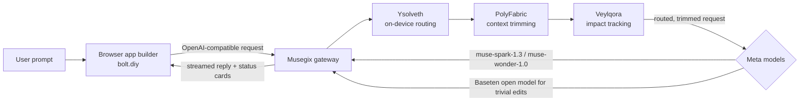

# Musegix

**An orchestration layer for AI app building with Meta's models.**

Musegix sits between a browser app builder and Meta's models. For every request, it decides which model should answer, what project context to send, and what a change affects, so each step costs fewer tokens and finishes faster.

[](LICENSE)

---

## The problem

AI coding agents resend the whole conversation and the project files on every step. Old tool output (file reads, command logs) is sent again even after the agent has used it. Every step costs tokens, money and time, and every edit runs the same expensive model, whether it's a colour change or a multi-file feature.

## The solution

Musegix adds three engines in front of the model. Each request passes through them in order:

| Engine | Job | What it saves or protects |
|---|---|---|
| **Ysolveth** | On-device routing. A small classifier runs on the CPU and picks the model for each request. | Cost and speed: simple edits go to a cheaper model, harder work to a stronger one. |
| **PolyFabric** | Context trimming. Shortens old tool output and sends only the project files a request needs. | Tokens: fewer tokens sent on every step. |
| **Veylqora** | Impact tracking. Fingerprints every function and component, and lists the files that depend on a changed export. | Fewer surprises: the model is told what else a change affects. |

Each reply shows a status card for the three engines: the model chosen, the tokens trimmed, and the files affected.



---

## Results

Measured on our own test runs. These are not general guarantees.

| Measure | Result | Where it comes from |
|---|---|---|
| Old tool output sent to the model | cut by **94%** on a test run (12,103 → 731 tokens) | `data/gateway.log`, `[polyfabric-tools]` |
| Project-file tokens on a large project | cut by **89.7%** (60,069 → 6,200) on a Kanban edit | earlier run; log not kept in the repo |
| Ysolveth routing time on CPU | warm p50 **1.8 ms** | `benchmarks/benchmark_results.json` |
| Ysolveth routing accuracy | **81%** on a 42-prompt held-out set (candidate head v5) | `reports/ysolveth_v5.md` |
| Veylqora stale-symbol detection | **100%** of mutated background symbols in our test set | `benchmarks/benchmark_results.md` |
| MBPP+ pass rate by model tier | cheap **83.9%**, mid **90.7%**, strong **87.8%** (378 tasks) | `data/labels/mbpp/full_results.jsonl` |

**Limits**
- Project-file savings depend on project size: small projects save little.
- Dollar savings are not measured, because model prices are not in this repo.
- The edit speed-up is not yet proven. Our timing runs did not show a clear gain from the symbol index.
- Veylqora's memory is stored but not yet fed back to the model.

---

## Certifications

Musegix has no certifications. The tests in `tests/` cover the gateway, tool-call enforcement, prompt extraction, pruning and symbol indexing. Run `python -m pytest -q tests` to check.

---

## Install

### Prerequisites
- Python 3.11 or newer
- Node.js with pnpm 9.15.9 or newer (for bolt.diy)
- A Meta Model API key, and a Baseten key for the open-weights model

### 1. Musegix gateway

```bash
pip install -r requirements.txt
cp .env.example .env          # then fill in META_API_KEY and BASETEN_API_KEY
python -m uvicorn gateway.app:app --port 8000
```

The gateway reads `.env` from the repo root.

### 2. bolt.diy (vendored in `vendor/bolt.diy`)

```bash
cd vendor/bolt.diy
pnpm install
pnpm run dev
```

Open `http://localhost:5173`. In the model selector, choose **Meta AI**. `vendor/bolt.diy/VENDORED.md` lists the upstream commit and the files changed for Musegix.

### 3. Optional: test and benchmark scripts

```bash
python -m pytest -q tests
```

---

## Repository layout

| Path | Contents |
|---|---|
| `gateway/` | FastAPI gateway, routing, pruning, symbol index, Veylqora guard |
| `gateway/engines/` | Ysolveth classifier, PolyFabric pruner, Veylqora guard, symbol index |
| `components/Ysolveth/` | Ysolveth encoder, tokenizer and classifier head |
| `vendor/bolt.diy/` | Modified copy of bolt.diy, with its own licence |
| `benchmarks/`, `reports/`, `docs/` | Benchmark results, training reports, metrics notes |
| `tests/` | Gateway and engine tests |

---

## Licence

Musegix code is licensed under the Apache License 2.0 (see [LICENSE](LICENSE)).

---

## Built on bolt.diy

Musegix's browser interface is a modified copy of [bolt.diy](https://github.com/stackblitz-labs/bolt.diy), which is MIT-licensed. The original licence is kept in `vendor/bolt.diy/LICENSE`.
