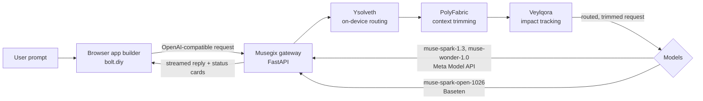

# Musegix

**An orchestration layer for AI app building with Meta's models.**

Musegix sits between a browser app builder and Meta's models. For every request it decides which model should answer, which project context to send, and what a change affects. The goal is fewer tokens, lower cost, and faster edits, without changing how the app builder works.

[](LICENSE)

---

## Contents

1. [The problem](#the-problem)
2. [What Musegix does](#what-musegix-does)
3. [Architecture](#architecture)
4. [The three engines](#the-three-engines)
5. [The gateway](#the-gateway)
6. [Models and training data](#models-and-training-data)
7. [Resource use](#resource-use)
8. [Results](#results)
9. [Use cases](#use-cases)
10. [Limits](#limits)
11. [Install](#install)
12. [Repository layout](#repository-layout)
13. [Tests](#tests)
14. [Licence and attribution](#licence-and-attribution)

---

## The problem

AI coding agents work in steps. On every step, the app builder resends:
- the whole conversation, including old tool output such as file reads and command logs that the agent has already used;
- the project files, or a large part of them.

So the cost of a step grows with the length of the session, not with the size of the change. Every edit also goes to the same model, whether it's a colour change or a multi-file feature. The result is more tokens, more money and more waiting per edit.

## What Musegix does

Musegix is an OpenAI-compatible proxy. The app builder points at it instead of at the model provider. Each request then passes through three engines:

| Engine | Question it answers | What it changes |
|---|---|---|
| **Ysolveth** | Which model should handle this request? | Picks a cheaper or stronger model, and runs on the CPU. |
| **PolyFabric** | What context does this request need? | Trims old tool output and sends only the project files it needs. |
| **Veylqora** | What else does this change affect? | Adds the list of dependent files to the reply's status cards. |

Each reply also shows status cards for the three engines: the tier and model chosen, the tokens trimmed, and the files affected.

## Architecture



- The **gateway** is the only thing the app builder talks to.
- **Ysolveth** runs in the gateway process, on the CPU, before any model call.
- **PolyFabric** and **Veylqora** run in the gateway, on each request.
- The **models** are called over the network. Their weights are not on your PC.

## The three engines

### Ysolveth: on-device routing

**What it does.** Ysolveth reads the user's latest request and classifies it into one of three tiers:

| Tier | Typical request | Model it routes to |
|---|---|---|
| TRIVIAL | a colour, text or spacing change | `muse-spark-open-1026` (Baseten) |
| MODERATE | a single feature or page | `muse-spark-1.3` (Meta Model API) |
| HARD | new systems, security, multi-service work | `muse-wonder-1.0` (Meta Model API) |

**How it works.**
1. The request text is tokenised (WordPiece, truncated to 256 tokens).
2. A frozen **all-MiniLM-L6-v2** sentence encoder, exported to **INT8 ONNX** (`encoder_int8.onnx`, about 22.9 MB), produces a 384-dimensional vector for the text. The vectors are mean-pooled over tokens and L2-normalised.
3. A **logistic regression** head maps the vector to three scores. The scores are divided by a temperature of 0.2842 and passed through softmax. The highest score gives the tier.

The encoder is never trained here. Only the small head is trained, which is why retraining takes seconds.

**Where the model comes from.** The encoder is the public `sentence-transformers/all-MiniLM-L6-v2`. The head is ours. See [Models and training data](#models-and-training-data).

**Cost on the CPU.** The session is created with 2 inference threads. In our runs:
- a short prompt takes about 1 ms once warm;
- a prompt of about 1,500 characters takes about 30 ms once warm;
- the first call in a new process takes longer (about 35–50 ms in our tests, and up to about 50 ms in the live gateway).

**Overrides.** Two rules can change the tier after classification: a scaffold-keyword rule that raises TRIVIAL prompts that mention things like "dashboard" or "application", and an escalation rule that moves a request up one tier after two failed tool results in a row.

### PolyFabric: context trimming

PolyFabric reduces what is sent to the model, in two places.

**1. Old tool output.** On every request, PolyFabric looks at the earlier tool results (file reads, searches, command output) in the conversation:
- the six most recent results are kept in full, so the agent can see what it just did;
- any result that reports a failure is kept in full, so the repair loop keeps its evidence;
- any other result longer than 400 characters is shortened to its first 160 characters, with a marker saying it was trimmed.

In our test runs, this cut old tool output by about 94%. Example from a logged request: `12,103 → 731 tokens`.

**2. Project files.** When the app builder sends project files:
- **Target files** named in the request are kept whole, so the model can edit them exactly. This is the *Target File Invariant*.
- For an edit that doesn't name a file, BM25 ranking over the file contents chooses the top two candidate files.
- Build artifacts (minified bundles, lock files, very long generated files) are replaced with a one-line stub.
- Other files are reduced to their signatures, using tree-sitter (for TypeScript and JavaScript) or Python's `ast`. Tokens are counted with tiktoken's `cl100k_base`.

On a large project, this reduced project-file tokens by about 90% on a Kanban edit. On small projects the saving is much smaller, because there is little to remove.

### Veylqora: impact tracking

Veylqora records the state of the code, so it can tell which other files a change affects.

**What it stores.** For each chat, a SQLite database (WAL mode) holds a SHA-256 fingerprint of:
- every file;
- every symbol inside the file: functions, classes, class methods, and top-level variables.

Symbols are extracted with tree-sitter for TypeScript and JavaScript, and with Python's `ast` for Python.

**How it's used.** When files are written or changed, Veylqora compares the new fingerprints with the stored ones:
- a symbol whose fingerprint changed is *mutated*;
- for each mutated, exported symbol, it finds the files that still reference it.

The status cards show the count of mutated symbols as "stale", and the list of referencing files as "dependent files". In our test set, it flagged 100% of mutated background symbols.

**What it doesn't do yet.** The stored history is not sent back to the model. A `cited_symbols` table exists for recording what the agent relied on, but the gateway doesn't fill it yet.

### The symbol index (part of the gateway)

A per-chat map of functions and components (file, start line, end line, hash) is built from file reads and from file writes as the model generates them. It is sent to the model as a short list, so the model can name a function it wants to change. Patches to known files are applied to the index as they're generated. We have not yet shown a speed gain from it.

## The gateway

The gateway is a FastAPI server that speaks the OpenAI chat-completions protocol, streamed over server-sent events. It handles:

- **Routing and trimming** for each request, using the three engines above.
- **Tool-call enforcement.** Meta's API accepts only `tool_choice: "auto"`, so the gateway emulates `required` and named tool choices: it narrows the tool list, adds an instruction, checks the reply, retries up to three times, and recovers tool calls that the model printed as text.
- **Repair escalation.** After two failed tool results in a row, the next request moves up one tier.
- **Status cards.** Each reply carries one status block with the tier, model, tokens trimmed, and dependent files.
- **Live activity.** `GET /v1/musegix/activity` reports in-flight and finished requests, for the test runner.

## Models and training data

| Component | Model or data | Source |
|---|---|---|
| Encoder (Ysolveth) | all-MiniLM-L6-v2, INT8 ONNX, 384-dimensional | public, `sentence-transformers` |
| Head v1 (current) | logistic regression, 3 classes, trained on hand-labelled software prompts | `components/Ysolveth/` (separate repo) |
| Head v5 (candidate, not in use) | logistic regression, same method, trained on 513 prompts: MBPP+ outcome labels and reviewed bolt-style prompts | `reports/ysolveth_v5.md` |
| Routing target: TRIVIAL | `muse-spark-open-1026` | Baseten |
| Routing target: MODERATE | `muse-spark-1.3` | Meta Model API |
| Routing target: HARD | `muse-wonder-1.0` | Meta Model API |

**Labels.** The v5 labels come from two sources, and they are kept apart:
- **MBPP+ outcome labels:** a prompt is TRIVIAL if the cheap model passes its tests, MODERATE if only the mid model passes, and HARD if only the strong model passes. These are measured, not guessed.
- **Bolt-style prompts:** 201 prompts written for this project and labelled against a written rubric. The labels are the author's judgement and have not been independently checked.

On a held-out split of 42 prompts, v5 reached 81% accuracy, compared with 64% for v1. That split is small, so treat the difference as indicative. v5 is **not** wired into the gateway. The gateway uses v1.

## Resource use

These numbers are from our runs on one Windows PC. They are not a formal benchmark.

| Part | Where it runs | What we measured |
|---|---|---|
| Ysolveth routing | your CPU, in the gateway process | about 1–30 ms per request once warm; 2 inference threads |
| PolyFabric and Veylqora | your CPU, in the gateway process | a few milliseconds per request on typical sizes; about 130 ms on the largest request we logged |
| Encoder and head | memory | the encoder file is about 22.9 MB on disk |
| Model inference | Meta and Baseten servers | not run locally |
| Gateway CPU and memory under load | not measured | — |

Nothing needs a GPU. Model calls use your internet connection.

## Results

Measured on our own runs. These are not general guarantees.

| Measure | Result | Source |
|---|---|---|
| Old tool output sent to the model | cut by **94%** (12,103 → 731 tokens, one logged request) | `data/gateway.log`, `[polyfabric-tools]` |
| Project-file tokens, large project | cut by **89.7%** (60,069 → 6,200), one Kanban edit | earlier run; its log is not kept in the repo |
| Ysolveth routing time on CPU | warm p50 **1.8 ms** | `benchmarks/benchmark_results.json` |
| Ysolveth routing accuracy | **81%** on a 42-prompt held-out set (v5, not in use) | `reports/ysolveth_v5.md` |
| Veylqora mutated-symbol detection | **100%** of mutated background symbols in our test set | `benchmarks/benchmark_results.md` |
| MBPP+ pass rate by tier | cheap **83.9%**, mid **90.7%**, strong **87.8%** (378 tasks each) | `data/labels/mbpp/full_results.jsonl` |

**What these do and don't show**
- The 94% is for old tool output, not total tokens. Total savings depend on how much of each request is old tool output.
- The 89.7% depends on project size.
- We have no dollar figures, because model prices are not in this repo.
- We have not shown a clear edit-speed gain from the symbol index.

## Use cases

- **Browser app builders that call an OpenAI-compatible API.** Point the builder at the gateway and keep its interface.
- **Cost control for agent sessions.** Long sessions stop paying again for old tool output, and simple edits go to cheaper models.
- **Safer multi-file edits.** The impact list shows which files depend on a changed export, so the agent and the user can check them.
- **Evaluating model tiers.** The MBPP+ outcome labels show how each tier does on the same tasks.
- **Research on routing.** The labelling method (outcome-based labels, held-out splits by task) can be reused for other routers.

## Limits

- **Routing is weak on hard tasks.** Some hard requests are sent to a cheaper model. v5 improves this on our test set, but it is not in use yet.
- **The labels for bolt-style prompts are the author's judgement.** They haven't been checked by a second person.
- **Savings depend on the project.** Small projects save little on project files.
- **Veylqora's history isn't used by the model yet.** It reports dependent files, but it doesn't remember more than that.
- **Edit speed is not proven.** The symbol index works, but our timing runs didn't show a clear gain.
- **Tool calls on large writes can be malformed.** The gateway logs these, but does not yet retry them.
- **It's a prototype.** The apps built through it are demonstrations, not production software.

## Install

### Prerequisites
- Python 3.11 or newer
- Node.js with pnpm 9.15.9 or newer (for bolt.diy)
- A Meta Model API key, and a Baseten key for the open-weights model

### 1. The gateway

```bash
pip install -r requirements.txt
cp .env.example .env          # then fill in META_API_KEY and BASETEN_API_KEY
python -m uvicorn gateway.app:app --port 8000
```

The gateway reads `.env` from the repo root. Keep `.env` on your machine; it is git-ignored.

### 2. bolt.diy (vendored in `vendor/bolt.diy`)

```bash
cd vendor/bolt.diy
pnpm install
pnpm run dev
```

Open `http://localhost:5173`. In the model selector, choose **Meta AI**. `vendor/bolt.diy/VENDORED.md` lists the upstream commit and the files changed for Musegix.

### 3. Check it works

```bash
python -m pytest -q tests
```

The known failing test is `tests/test_mcp_render.py::test_polyfabric_symbol_search_empty_and_miss`. It matches an unrelated symbol name and is documented as known.

## Repository layout

| Path | Contents |
|---|---|
| `gateway/` | FastAPI gateway, routing, prompt extraction, tool-call enforcement |
| `gateway/engines/` | Ysolveth classifier, PolyFabric pruners, Veylqora guard, symbol index, repair helpers |
| `vendor/bolt.diy/` | Modified copy of bolt.diy, with its own licence and `VENDORED.md` |
| `benchmarks/` | Benchmark results (JSON and summary) |
| `reports/` | Routing-head training reports |
| `scripts/` | Test runners, training and labelling scripts, landing-page and branding scripts |
| `tests/` | Gateway and engine tests |
| `docs/` | Metrics notes |

The Ysolveth model files live in `components/Ysolveth/`, which is a separate repository. The label data used for training is in `data/`, which is git-ignored.

## Tests

```bash
python -m pytest -q tests
```

The tests cover tool-call enforcement, prompt extraction, tool-output pruning, the symbol index and its patches, status-card data, Veylqora's change detection, and the streaming format.

## Licence and attribution

Musegix's own code is licensed under the Apache License 2.0 (see [LICENSE](LICENSE)).

Its browser interface is a modified copy of [bolt.diy](https://github.com/stackblitz-labs/bolt.diy), which is MIT-licensed. The original licence is kept in `vendor/bolt.diy/LICENSE`.
